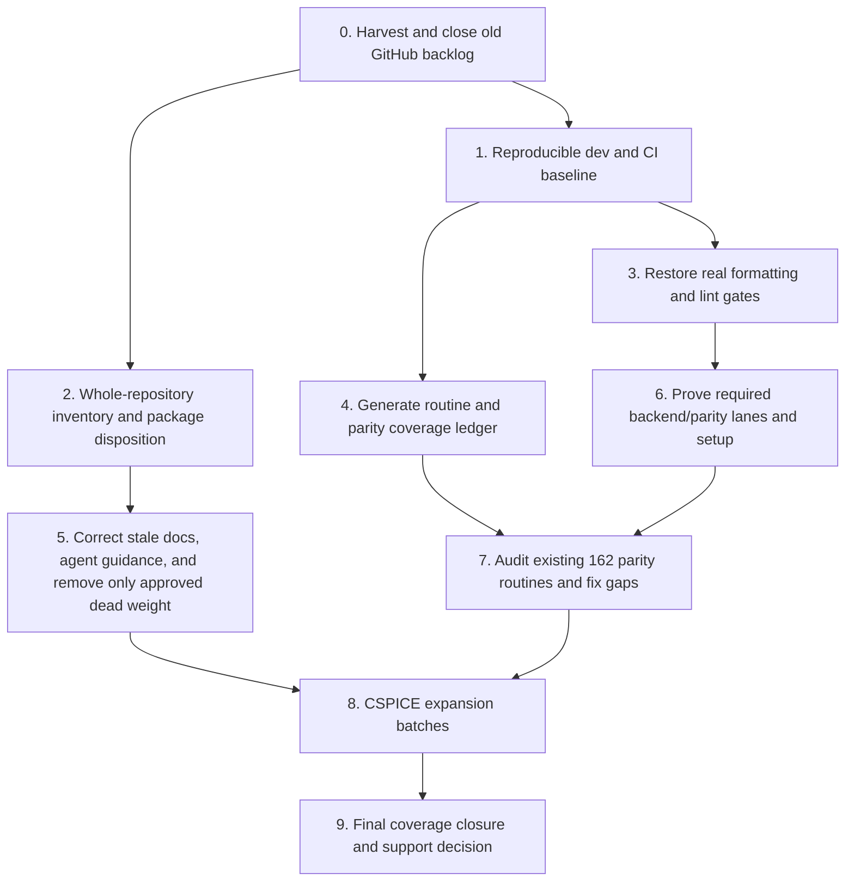

# Project reset and coverage plan

## Purpose

Reset the project’s planning surface, restore confidence in the developer and CI workflow, and then close the remaining CSPICE API implementation gap with measured Node/WASM parity. The goal is to keep the existing contract / backend / shared C shim architecture and the live SpiceyPy oracle strategy, while making the work easier to extend and review.

This is the working plan for the reset and subsequent coverage work. Phase 0 was completed on 2026-11-02: after harvesting the live backlog and PR feedback, all 42 open issues and 5 open PRs were closed without merging, and the repository’s open issue and PR lists were verified empty. The setup and inventory checkpoint below records subsequent work.

## Execution checkpoint — 2026-11-02

Steps 1 and 2 have completed their first implementation/audit pass. Step 1 now has a tiered setup guide and read-only prerequisite profiles; the required JS and native lanes passed locally. Step 2 records the package, workflow, script, fixture, and generated-artifact inventory. The audit recommends removing the isolated `perf-analysis` scaffold in a follow-up after confirming there is no private use. It also records unresolved gates, doc drift, setup quirks, and the native SDK mismatch. No CSPICE API expansion or broad package cleanup has started.

Step 6 has a concrete CI finding to carry forward: CI sets `TSPICE_EXPECT_NATIVE=true`, but root `turbo.json` uses strict environment filtering and omits that variable from `globalEnv`. The native-presence sanity test is therefore skipped inside Turbo. The small configuration fix and proof that the assertion runs can proceed alongside steps 3–5; the broader lane audit in step 6 retains its other prerequisites.

## Current baseline

Snapshot reviewed 2026-11-02:

- The parity registry contains 305 scenarios across 162 routine-named case files. Local JS validation executed all 305 WASM cases; native validation executed the WASM and Node scenarios. The `TSPICE_EXPECT_NATIVE` sanity assertion itself is currently filtered out by Turbo's strict environment mode, as recorded in the readiness audit.
- `data/cspice-functions.json` and the generated routine inventory describe 652 CSPICE routines: 162 implemented, 487 planned, and 3 explicitly excluded. That is 24.8% of all listed routines, or 25.0% of the 649 eligible routines. The excluded routines are Fortran-unit or interactive-I/O entry points.
- All 162 implemented routine names reconcile with one same-named `*.cases.json` parity case file under `packages/py-parity-checking/src/cases/`. The harness iterates registered cases against the live SpiceyPy sidecar and WASM; it also runs Node cases when the native backend is available. This establishes case-file presence, not case quality, required CI execution, or meaningful scenario depth. Treat effective parity coverage as unverified until those are audited.
- The top-level `format:check` is a recursive optional workspace call, and `lint` runs the JSDoc script followed by a recursive optional workspace call. The currently listed packages do not declare matching workspace scripts, so general formatting and linting appear to be vacuous. Confirm this as the first technical fix; do not rely on #616’s package list as current (it names paths that are absent).
- The pre-reset GitHub snapshot contained 42 issues and 5 open PRs. PR #523 proposes generic coverage reporting, while #616 describes the likely lint/format defect. Other open items mix release-era planning, old performance proposals, docs follow-ups, and feature requests. They are not a dependable priority queue.
- Repo structure to assess: `packages/tspice` (public facade), `backend-contract`, `backend-node`, `backend-wasm`, `backend-shim-c`, `backend-fake`, `core`, `py-parity-checking`, `perf-analysis`, three platform native packages, `apps/docs`, and `fixtures/consumer-nodom`. `perf-analysis` describes itself as layout-only; `backend-wasm` still describes itself as a reserved slot despite being implemented. `docs/cspice-planned-functions-by-domain.md` reports 648 planned routines, which conflicts with the current generated inventory’s 487.
- The project pins Node-compatible scripts and pnpm, uses a Python/SpiceyPy sidecar, fetches CSPICE for native checks, and has a Nix flake. A contributor machine may not have those utilities. Local setup should be discovered and documented by task tier; the GitHub runners remain the final validation authority.

## Working rules for the reset

1. Preserve the facade / contract / backend boundaries and shared C shim unless the inventory shows a specific defect. Every new raw CSPICE binding remains end-to-end: contract, C shim, Node native path, WASM path, parity scenario, and mapping/docs.
2. Keep three measures distinct: CSPICE routine implementation breadth (649 eligible routines), meaningful oracle parity (per routine/scenario and backend), and ordinary source line/branch coverage. A high line-coverage percentage cannot substitute for CSPICE parity.
3. Keep the live SpiceyPy oracle as the reference strategy. Improve only the harness properties needed to make execution trustworthy, repeatable, and visible.
4. Do not delete a package because it looks small or unfinished. Record who imports it, what workflow uses it, what publish artifact it supports, and what replaces it before proposing removal.
5. Batch API additions by cohesive behavior and dependency, not by arbitrary issue number. A routine is complete only when all agreed layers are implemented and required checks pass.

## Phase 0 — Harvest, then reset GitHub state

**Operational step; not a code PR. Completed 2026-11-02.** Reviewed all 42 open issue bodies and comment threads, plus the full diffs and review threads of the 5 open PRs: [#577](https://github.com/rybosome/tspice/pull/577), [#576](https://github.com/rybosome/tspice/pull/576), [#573](https://github.com/rybosome/tspice/pull/573), [#523](https://github.com/rybosome/tspice/pull/523), and [#388](https://github.com/rybosome/tspice/pull/388). The findings below are preserved as current audit candidates; old issue wording and PR branches are not treated as authoritative.

All 42 issues were closed with `not_planned` state reason and a note explaining the backlog reset. All 5 PRs were closed without merging and given a note that any retained work will be re-scoped against current main. A fresh GitHub query confirmed zero open issues and zero open PRs. No replacement issues were opened.

### Harvested findings to carry forward

These are ideas or defects to verify in the planned audit, not an assertion that old branches are ready to merge:

- **Required style gates:** #616’s central claim checks out against root scripts and current workspace manifests: recursive optional lint/format calls have no active package-level targets beyond JSDoc lint. Restore a real fail-closed gate.
- **Parity must be backend-specific:** the open review on #576 confirms a concrete existing hole: `kplfrm` is in the public contract and Node backend, but the WASM implementation currently throws “not supported”. The ledger must distinguish method/case presence from Node route, WASM route, and actually executed oracle parity. Decide whether to implement this on WASM or explicitly document a supported-backend exception.
- **One canonical method map:** #570/#556/#567/#569 and their PRs contain useful mapping audit work, but they disagree in freshness and location. Preserve the invariant that every raw method has an evidence-backed direct or non-direct classification with behavior and backend caveats. Keep that map in one maintained/generated location; do not duplicate free-form annotations across docs and JSDoc without a clear source of truth. Clearly separate CSPICE guarantees from tspice wrapper semantics.
- **Public API surface audit:** #556 identified candidate questions around `kernels.custom()` argument shape, `origin`/`baseUrl` semantics, empty `withKernels()` input, and redundant overloads. Carry these into the repository inventory as questions to re-check against current code and user intent; do not treat its old 0.1.0 framing or recommendations as decisions.
- **Error diagnostics:** #577’s useful design points are consistent, actionable `Expected/Got` validation messages and one safe shared formatter (including circular and BigInt inputs). Its branch has review feedback and is not a merge recommendation; first inspect what is already on current main.
- **Coverage reporting:** #522/#523 addressed ordinary line/branch coverage, which is a different metric from supported CSPICE routines and oracle parity. Preserve it only as a supplementary signal after verifying package discovery, current package names, PR-fork permissions, and missing-report behavior; its current PR is non-mergeable and has unresolved review threads.
- **Support/release checks:** #554/#555 suggest useful checks for platform × runtime × backend support and published-artifact install smoke tests, but their 0.1.0 matrix includes the removed Orrery app and older workflow names. Rebuild such a matrix from current artifacts and CI; no release version is implied.
- **Platform scope:** #457/#459/#466 discussions indicate Linux ARM64 CSPICE compilation was demonstrated through Nix, while published native package and required CI support were still described as missing. If still true, decide deliberately whether Linux ARM64 is a supported target; respect NAIF redistribution restrictions and prefer verified source/build flows over mirroring unmodified toolkit archives.
- **Benchmarks are optional follow-up:** #337/#388 and #195 contain a potentially useful repo-owned benchmark contract and portable result output, but the PR is non-mergeable and review noted cwd-dependent fixture resolution, unsafe normalization assumptions, and timing/validation edge cases. Do not let this block extension work; reassess only after a concrete performance question exists.
- **Likely obsolete or already implemented:** #358 comments state DAS/DLA handle semantics landed in merged PR #323. #88 needs a current case/fixture check because CK assets and parity cases now exist. #142/#183 are viewer UI tasks outside the current repo; older docs, perf-roadmap, worker batching, and 0.1.0 issues should not be retained without a current, reproducible need.

For the five open PRs, the review surfaced unresolved or operational concerns: #577 has an unresolved formatter thread despite a claimed fix; #576 has documentation duplication and an unresolved WASM `kplfrm` gap; #573’s content is useful but mapping terms and unsupported behavior need a canonical convention; #523 is non-mergeable with 18 review threads, including hard-coded package scope and CI artifact/permissions concerns; #388 is non-mergeable with correctness and reproducibility concerns. They were closed during the backlog reset; the retained findings above remain in this work plan.

## Ordered work and parallel workstreams

The DAG below is the recommended order. The numbered descriptions follow a topological order; steps with no dependency path between them can run concurrently after their stated prerequisites. In particular, steps 1 and 2 are parallel, as are steps 3, 4, and 5 once their respective prerequisites are met.

### Workstream 1 — Contributor setup and repository truth

**1. Reproducible dev and CI baseline (one PR).** Inventory what is installed on the working machine; do not assume Node, pnpm, Python/uv, a native compiler, CSPICE, or Emscripten is present. Define and document the minimum Node/pnpm bootstrap, Python/SpiceyPy setup, native prerequisites, CSPICE fetch/cache behavior, and the narrower requirements for WASM artifact regeneration. Add a small read-only prerequisite/doctor command or explicit preflight with actionable missing-tool messages. Demonstrate the documented JS-only and native validation entrypoints on a clean checkout or CI; avoid requiring Emscripten for ordinary JS-only contribution. Keep platform coverage claims aligned with actual CI and shipped native packages.

**2. Whole-repository inventory and package disposition (one audit PR).** Record each package/app/script/fixture/workflow’s purpose, dependents, inputs/outputs, generated artifacts, validation lane, publish role, and maintainer entrypoint. Trace workspace dependencies and package exports, plus CI and release workflows. Make explicit keep / complete / consolidate / remove recommendations, with evidence. At minimum decide the future of the layout-only `perf-analysis` package, confirm why `backend-fake` and `consumer-nodom` are needed, and retain the native wrapper packages if required for published installs. This PR establishes decisions; make actual removals only in a follow-up with dependency and CI proof.

### Workstream 2 — Trustworthy quality and parity signals

**3. Restore real formatting and lint gates (one PR; after step 1).** Replace vacuous optional recursive calls with deterministic commands that evaluate tracked source and documentation/config scopes. Define generated/binary exclusions. Make root `format:check`, `lint`, and `check:js:required` fail when no files are evaluated or a real violation exists. Add a formatter write command if useful, stage any one-time formatting churn separately from rule/config changes, and document exact local commands. Include a guard against reverting to no-op gates. This is the concrete item to harvest from #616, after verifying current package scripts and workflows.

**4. Generate a routine and parity coverage ledger (one PR; can proceed alongside step 3 once step 1 is known).** Generate a machine-readable report from the canonical CSPICE inventory, contract surface, parity case registry, and backend dispatch/known exceptions. Each eligible routine should show: inventory decision; contract method; C shim symbol; Node route; WASM route; registered parity case(s); required fixture/kernel; and per-backend CI lane. Explicitly classify unsupported/non-direct behavior instead of counting it as direct 1:1 CSPICE support. Fail CI on unexplained drift (for example, a newly implemented method without a parity case or a case that points to no contract method). Keep line/branch coverage output as a separate view; evaluate #523’s workflow/report ideas, but do not adopt PR comments unless the signal is clear, secure, and maintainable.

**5. Correct stale docs, agent guidance, and approved dead weight (one PR or small linked PRs; depends on step 2; can run alongside steps 3–4).** Bring README, package READMEs, architecture docs, contributor setup, `AGENTS.md`, generated routine reports, `llms.txt`, and docs-site pages into agreement with inspected code. Remove duplicated or stale policy and obsolete roadmap language; keep the agent guide short and focused on stable invariants, routing, and required verification. Regenerate generated files with their owning scripts. Address known drift including the 648-planned-functions report and the obsolete “reserved WASM slot” description. Delete packages or instructions only when step 2 identifies a concrete replacement or confirms they are unused.

**6. Prove required backend/parity lanes and setup (one PR; after steps 1 and 3).** Inspect CI job conditions and test skipping. Make the required CI matrix explicitly prove WASM and native Node execution, and prove each is compared to the live SpiceyPy result where parity is claimed. Native checks must fail closed when native is expected but unavailable; local optional skips may stay optional. Ensure fixture setup, cleanup, tolerances, error normalization, and execution markers are understandable from logs. Audit stale issue references in workflow comments (including the closed #594 reference) and replace them with durable rationale or remove them. Keep expensive/platform-specific checks in clearly named lanes.

**7. Audit the existing 162 parity routines (one or more PRs split by domain; after steps 4 and 6).** Review each case’s actual workflow and assertion against CSPICE semantics and the raw mapping—not just file presence. Label scenarios as direct, composed/non-direct, error-only, stateful fixture-backed, or not meaningfully exercised; then add or repair happy-path, edge, and error cases according to routine behavior. Verify both backends against SpiceyPy with required execution in CI. Add missing fixtures only when a minimal deterministic fixture is needed; document provenance and licensing. Update the ledger in the same PR as each case change.

### Workstream 3 — Close the CSPICE implementation gap

**8. CSPICE expansion batches (many PRs, parallel within dependency waves).** Start only once steps 1, 3, 4, and 6 are complete; early low-dependency batches may overlap the latter part of step 7 if the ledger and acceptance rules are stable. Derive exact routine lists from the generated planned inventory, never from stale issue titles. Each PR should target one cohesive slice (usually about 5–15 routines; larger only for a tightly coupled family), and list the exact NAIF routine names in its description. Suggested topological waves:

1. **Independent utility foundations:** simple scalar/math, strings, and remaining coordinate/vector operations. These have few kernel and fixture dependencies and are suitable first parallel tasks.
2. **State and shared primitives:** cells/windows, error behavior, kernel-pool access, and kernel bookkeeping. Keep mutable-state lifecycle and serialization assumptions explicit.
3. **File and kernel-backed data foundations:** DAF/DAS/DLA and shared file I/O, then EK/PCK/CK support as dependencies permit. Ensure handle kinds, close semantics, path virtualization, and fixture generation are covered.
4. **Time, names, and frames:** SCLK/time additions, ID/name translations, frame metadata/transforms, and dependent CK operations. Declare required LSK/SCLK/FK/PCK fixtures per routine.
5. **Ephemeris and geometric computation:** SPK access/writing and coverage, then geometry/FOV and geometry-finder families, followed by DSK families where file and surface-model prerequisites are ready.

The domain list is a starting taxonomy, not a fixed implementation order: use actual NAIF routine dependencies and the contract to split batches. Work in different dependency-safe slices can proceed in parallel, but only one PR should own a given routine or shared ABI change at a time. Avoid a single PR that adds an entire large domain (for example, all 121 planned coordinate/vector routines or all 84 geometry routines).

**Per-routine completion contract for every expansion PR:** (a) verify NAIF signature, semantics, units, state, and error behavior; (b) add typed contract method and direct/non-direct mapping; (c) implement/extend the shared C shim where required; (d) wire Node native and WASM with matching output layout, memory ownership, errors, and handles; (e) add a live SpiceyPy case with a deterministic fixture or explicit no-kernel setup, meaningful success coverage, and relevant edge/error behavior; (f) add JS/backend tests for wrapper-specific validation and lifecycle behavior; (g) update generated inventory/ledger and public JSDoc/docs; (h) run the narrow package checks plus required repo JS, parity, and native CI lanes. The CI result, not a workstation-only pass, is merge evidence.

**9. Final coverage closure and support decision (one release-readiness PR after all batches).** Require 649/649 eligible routines either implemented end-to-end or accompanied by an explicit maintainer decision changing the eligible inventory; retain clear reasons for the three exclusions. Verify generated inventory counts, no unregistered methods/cases, and required Node/WASM-vs-SpiceyPy execution for every routine claimed as parity-covered. Publish a final backend/platform support matrix based on actual CI and artifacts, then update the README/docs with precise coverage and limitations. Decide separately whether to release; do not carry forward a 0.1.0 target merely because old issues mentioned it.

## PR handoff template for distributed work

Every assigned PR should state:

- Exact routine names or exact repository surface owned; explicit out-of-scope items.
- Dependencies and fixtures/kernels needed, including licensing/provenance for added data.
- Contract and backend mapping, including any intentional Node/WASM divergence.
- Parity scenarios and what each asserts; whether required Node and WASM lanes executed.
- Commands actually run, CI checks still pending, and any known test or platform gap.
- Generated files updated, and the source command that regenerates them.

Do not assign a broad prompt such as “implement the next domain.” Give each agent a bounded routine list from the ledger, its prerequisites, the files/layers expected to change, and this completion contract. The integrator owns cross-backend consistency and CI acceptance.
